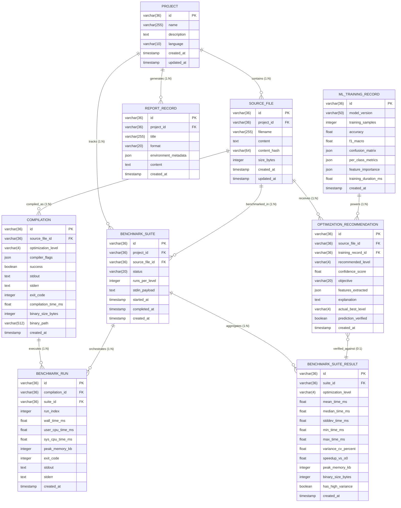

# CompilerX — Database Schema & Data Persistence Specification
**AI-Powered Adaptive Code Optimization and Performance Analysis System**

---

| Field | Value |
|---|---|
| **Document Version** | 1.0.0 |
| **Status** | APPROVED — Technical Design Baseline |
| **Author** | Principal Software Architect & Technical Lead |
| **Target Course** | Adaptive Software Engineering (24CI3201), KL University |
| **Database Engine** | SQLite 3.45+ (WAL Mode) for Development; PostgreSQL 16 Compatible |
| **ORM & Migrations**| SQLAlchemy 2.0 (Asyncio) + Alembic 1.13+ |
| **Last Updated** | 2026-11-06 |

---

## 1. Persistence Overview & Architectural Strategy

CompilerX utilizes a relational storage model managed through **SQLAlchemy 2.0** asynchronous ORM and version-controlled via **Alembic** migrations. 

### 1.1 Engine Strategy: SQLite (Dev) ↔ PostgreSQL (Prod)
1. **Local Development (Default):** SQLite configured in **Write-Ahead Logging (WAL)** mode. This delivers zero-configuration, self-contained execution without requiring an external database daemon container, while safely supporting concurrent reads and single-writer transactions with a 5000ms busy timeout.
2. **Production / Multi-Tenant (Optional):** All data types, UUID primary keys, JSON columns, and foreign key constraints are strictly written using standard SQL primitives supported natively by PostgreSQL 16. Switching engines requires only changing the `DATABASE_URL` environment variable (e.g. from `sqlite+aiosqlite:///...` to `postgresql+asyncpg://...`).

### 1.2 Concurrency & Connection Tuning for SQLite WAL Mode
When running on SQLite, the application executes the following pragmas on connection acquisition:
```sql
PRAGMA journal_mode = WAL;
PRAGMA synchronous = NORMAL;
PRAGMA foreign_keys = ON;
PRAGMA busy_timeout = 5000;
PRAGMA cache_size = -64000; -- 64MB memory cache
```

---

## 2. Entity-Relationship Diagram (ERD)



---

## 3. Relational Table Specifications & Data Dictionaries

### 3.1 Table: `projects`
Stores high-level workspace containers grouping source files, compilations, and benchmarks.

| Column | Data Type | Nullable | Default | Description |
|---|---|---|---|---|
| `id` | `VARCHAR(36)` | NO | UUIDv4 | Primary key (string-encoded UUIDv4). |
| `name` | `VARCHAR(255)` | NO | — | User-defined project name. |
| `description` | `TEXT` | YES | NULL | Project documentation or description. |
| `language` | `VARCHAR(10)` | NO | `'c'` | Base language: `'c'` or `'cpp'`. |
| `created_at` | `TIMESTAMP` | NO | `CURRENT_TIMESTAMP` | Creation timestamp (UTC). |
| `updated_at` | `TIMESTAMP` | NO | `CURRENT_TIMESTAMP` | Last modification timestamp (UTC). |

- **Indexes:**
  - `idx_projects_name` ON `projects(name)`
  - `idx_projects_created_at` ON `projects(created_at DESC)`

---

### 3.2 Table: `source_files`
Stores C and C++ source code files. Each update or new file triggers SHA-256 digest calculation.

| Column | Data Type | Nullable | Default | Description |
|---|---|---|---|---|
| `id` | `VARCHAR(36)` | NO | UUIDv4 | Primary key. |
| `project_id` | `VARCHAR(36)` | NO | — | Foreign key referencing `projects(id)` ON DELETE CASCADE. |
| `filename` | `VARCHAR(255)` | NO | — | File name ending in `.c` or `.cpp`. |
| `content` | `TEXT` | NO | — | Complete raw source code text (up to 1 MB). |
| `content_hash` | `VARCHAR(64)` | NO | — | SHA-256 hexadecimal digest of `content`. |
| `size_bytes` | `INTEGER` | NO | — | Byte length of `content`. |
| `created_at` | `TIMESTAMP` | NO | `CURRENT_TIMESTAMP` | Record creation timestamp. |
| `updated_at` | `TIMESTAMP` | NO | `CURRENT_TIMESTAMP` | Last update timestamp. |

- **Indexes:**
  - `idx_source_files_project_id` ON `source_files(project_id)`
  - `idx_source_files_hash` ON `source_files(content_hash)`

---

### 3.3 Table: `compilations`
Stores compilation invocations, parameters, compiler output, and generated binary metadata.

| Column | Data Type | Nullable | Default | Description |
|---|---|---|---|---|
| `id` | `VARCHAR(36)` | NO | UUIDv4 | Primary key. |
| `source_file_id` | `VARCHAR(36)` | NO | — | Foreign key referencing `source_files(id)` ON DELETE CASCADE. |
| `optimization_level` | `VARCHAR(4)` | NO | — | Target level: `'-O0'`, `'-O1'`, `'-O2'`, `'-O3'`. |
| `compiler_flags` | `JSON` | NO | `'[]'` | JSON array of auxiliary flags (e.g. `["-Wall", "-ffast-math"]`). |
| `success` | `BOOLEAN` | NO | — | `TRUE` if exit code is 0; `FALSE` otherwise. |
| `stdout` | `TEXT` | NO | `''` | Standard output captured from Clang. |
| `stderr` | `TEXT` | NO | `''` | Standard error / diagnostics captured from Clang. |
| `exit_code` | `INTEGER` | NO | — | Process exit status integer. |
| `compilation_time_ms`| `FLOAT` | NO | — | Duration of compilation in milliseconds. |
| `binary_size_bytes` | `INTEGER` | YES | NULL | Executable file size in bytes (NULL if compilation failed). |
| `binary_path` | `VARCHAR(512)`| YES | NULL | Ephemeral build artifact path in sandbox storage. |
| `created_at` | `TIMESTAMP` | NO | `CURRENT_TIMESTAMP` | Compilation timestamp. |

- **Indexes:**
  - `idx_compilations_file_opt` ON `compilations(source_file_id, optimization_level)`
  - `idx_compilations_created_at` ON `compilations(created_at DESC)`

---

### 3.4 Table: `benchmark_suites`
Represents an orchestrated multi-level benchmark run across `-O0`, `-O1`, `-O2`, and `-O3`.

| Column | Data Type | Nullable | Default | Description |
|---|---|---|---|---|
| `id` | `VARCHAR(36)` | NO | UUIDv4 | Primary key. |
| `project_id` | `VARCHAR(36)` | NO | — | Foreign key referencing `projects(id)` ON DELETE CASCADE. |
| `source_file_id` | `VARCHAR(36)` | NO | — | Foreign key referencing `source_files(id)` ON DELETE CASCADE. |
| `status` | `VARCHAR(20)` | NO | `'PENDING'` | Status: `'PENDING'`, `'RUNNING'`, `'COMPLETED'`, `'FAILED'`. |
| `runs_per_level` | `INTEGER` | NO | `5` | Repetition count per optimization level (default: 5). |
| `stdin_payload` | `TEXT` | YES | NULL | Test input piped to program `stdin`. |
| `started_at` | `TIMESTAMP` | YES | NULL | Execution start timestamp. |
| `completed_at` | `TIMESTAMP` | YES | NULL | Execution completion timestamp. |
| `created_at` | `TIMESTAMP` | NO | `CURRENT_TIMESTAMP` | Creation timestamp. |

- **Indexes:**
  - `idx_suites_file_id` ON `benchmark_suites(source_file_id)`
  - `idx_suites_status` ON `benchmark_suites(status)`

---

### 3.5 Table: `benchmark_runs`
Captures an individual, isolated process execution run within an active benchmark suite.

| Column | Data Type | Nullable | Default | Description |
|---|---|---|---|---|
| `id` | `VARCHAR(36)` | NO | UUIDv4 | Primary key. |
| `compilation_id` | `VARCHAR(36)` | NO | — | Foreign key referencing `compilations(id)` ON DELETE CASCADE. |
| `suite_id` | `VARCHAR(36)` | YES | NULL | Optional foreign key referencing `benchmark_suites(id)`. |
| `run_index` | `INTEGER` | NO | — | 1-based iteration index ($1 \dots N$). |
| `wall_time_ms` | `FLOAT` | NO | — | Elapsed wall-clock time in milliseconds via `CLOCK_MONOTONIC_RAW`. |
| `user_cpu_time_ms` | `FLOAT` | NO | — | User-mode CPU time in milliseconds via `rusage`. |
| `sys_cpu_time_ms` | `FLOAT` | NO | — | Kernel-mode CPU time in milliseconds via `rusage`. |
| `peak_memory_kb` | `INTEGER` | NO | — | Peak Resident Set Size (RSS) in kilobytes. |
| `exit_code` | `INTEGER` | NO | — | Execution exit status (0 = success, 137 = OOM/Killed, 143 = Timeout). |
| `stdout` | `TEXT` | NO | `''` | Output captured from process standard output. |
| `stderr` | `TEXT` | NO | `''` | Output captured from process standard error. |
| `created_at` | `TIMESTAMP` | NO | `CURRENT_TIMESTAMP` | Execution timestamp. |

- **Indexes:**
  - `idx_bench_runs_compilation` ON `benchmark_runs(compilation_id)`
  - `idx_bench_runs_suite` ON `benchmark_runs(suite_id)`

---

### 3.6 Table: `benchmark_suite_results`
Stores aggregated statistical summaries across all iterations for each optimization level in a suite.

| Column | Data Type | Nullable | Default | Description |
|---|---|---|---|---|
| `id` | `VARCHAR(36)` | NO | UUIDv4 | Primary key. |
| `suite_id` | `VARCHAR(36)` | NO | — | Foreign key referencing `benchmark_suites(id)` ON DELETE CASCADE. |
| `optimization_level` | `VARCHAR(4)` | NO | — | Level: `'-O0'`, `'-O1'`, `'-O2'`, `'-O3'`. |
| `mean_time_ms` | `FLOAT` | NO | — | Arithmetic mean wall time ($\mu$). |
| `median_time_ms` | `FLOAT` | NO | — | Median wall time ($M$). |
| `stddev_time_ms` | `FLOAT` | NO | — | Sample standard deviation ($s$). |
| `min_time_ms` | `FLOAT` | NO | — | Minimum observed wall time. |
| `max_time_ms` | `FLOAT` | NO | — | Maximum observed wall time. |
| `variance_cv_percent`| `FLOAT` | NO | — | Coefficient of variation: $(\frac{s}{\mu} \times 100\%)$. |
| `speedup_vs_o0` | `FLOAT` | NO | `1.0` | Calculated speedup factor: $(\frac{\mu_{O0}}{\mu_{Ox}})$. |
| `peak_memory_kb` | `INTEGER` | NO | — | Maximum peak RSS across runs. |
| `binary_size_bytes` | `INTEGER` | NO | — | Byte size of compiled binary. |
| `has_high_variance` | `BOOLEAN` | NO | `FALSE` | Set to `TRUE` if $CV > 15\%$. |
| `created_at` | `TIMESTAMP` | NO | `CURRENT_TIMESTAMP` | Aggregation timestamp. |

- **Indexes:**
  - `idx_suite_results_suite_opt` ON `benchmark_suite_results(suite_id, optimization_level)`

---

### 3.7 Table: `optimization_recommendations`
Stores predictions generated by the Machine Learning model, including extracted features and explainability rationales.

| Column | Data Type | Nullable | Default | Description |
|---|---|---|---|---|
| `id` | `VARCHAR(36)` | NO | UUIDv4 | Primary key. |
| `source_file_id` | `VARCHAR(36)` | NO | — | Foreign key referencing `source_files(id)` ON DELETE CASCADE. |
| `training_record_id`| `VARCHAR(36)` | YES | NULL | Foreign key referencing `ml_training_records(id)`. |
| `recommended_level` | `VARCHAR(4)` | NO | — | Model prediction: `'-O0'`, `'-O1'`, `'-O2'`, `'-O3'`. |
| `confidence_score` | `FLOAT` | NO | — | Softmax / probability output ($0.00 \dots 1.00$). |
| `objective` | `VARCHAR(20)` | NO | `'SPEED'` | Optimization goal: `'SPEED'`, `'SIZE'`, `'BALANCED'`. |
| `features_extracted`| `JSON` | NO | — | 16-dimensional feature vector snapshot in JSON. |
| `explanation` | `TEXT` | NO | — | Human-readable justification generated from feature importances. |
| `actual_best_level` | `VARCHAR(4)` | YES | NULL | Populated after empirical benchmarking for validation. |
| `prediction_verified`| `BOOLEAN` | YES | NULL | `TRUE` if `recommended_level == actual_best_level`. |
| `created_at` | `TIMESTAMP` | NO | `CURRENT_TIMESTAMP` | Prediction timestamp. |

- **Indexes:**
  - `idx_recs_source_file` ON `optimization_recommendations(source_file_id)`

---

### 3.8 Table: `ml_training_records`
Stores model training lifecycle metadata, evaluation metrics, and feature importance tables (**CO4: MLOps**).

| Column | Data Type | Nullable | Default | Description |
|---|---|---|---|---|
| `id` | `VARCHAR(36)` | NO | UUIDv4 | Primary key. |
| `model_version` | `VARCHAR(50)` | NO | — | Semantic version identifier (e.g. `'v1.0.0-rf100'`). |
| `training_samples` | `INTEGER` | NO | — | Total number of benchmark programs in training split. |
| `accuracy` | `FLOAT` | NO | — | Test split classification accuracy ($0.0 \dots 1.0$). |
| `f1_macro` | `FLOAT` | NO | — | Macro-averaged F1 score across all classes. |
| `confusion_matrix` | `JSON` | NO | — | $4 \times 4$ integer array representing classification matrix. |
| `per_class_metrics` | `JSON` | NO | — | Precision, recall, and F1 broken down per optimization flag. |
| `feature_importance`| `JSON` | NO | — | Normalized Gini importance map for all 16 features. |
| `training_duration_ms`|`FLOAT` | NO | — | Time taken to fit model in milliseconds. |
| `created_at` | `TIMESTAMP` | NO | `CURRENT_TIMESTAMP` | Training completion timestamp. |

---

### 3.9 Table: `report_records`
Stores generated performance audits, complete with environment stamps and markdown payloads.

| Column | Data Type | Nullable | Default | Description |
|---|---|---|---|---|
| `id` | `VARCHAR(36)` | NO | UUIDv4 | Primary key. |
| `project_id` | `VARCHAR(36)` | NO | — | Foreign key referencing `projects(id)` ON DELETE CASCADE. |
| `title` | `VARCHAR(255)` | NO | — | Report document title. |
| `format` | `VARCHAR(20)` | NO | `'MARKDOWN'` | Export format: `'MARKDOWN'`, `'JSON'`, or `'HTML'`. |
| `environment_metadata`| `JSON`| NO | — | Hardware environment: CPU, OS, Clang version, RAM limit. |
| `content` | `TEXT` | NO | — | Serialized report payload. |
| `created_at` | `TIMESTAMP` | NO | `CURRENT_TIMESTAMP` | Report generation timestamp. |

---

## 4. Complete Declarative DDL (PostgreSQL & SQLite Compatible)

```sql
-- CompilerX Database Initialization DDL

-- 1. Projects
CREATE TABLE IF NOT EXISTS projects (
    id VARCHAR(36) PRIMARY KEY,
    name VARCHAR(255) NOT NULL,
    description TEXT,
    language VARCHAR(10) NOT NULL DEFAULT 'c',
    created_at TIMESTAMP NOT NULL DEFAULT CURRENT_TIMESTAMP,
    updated_at TIMESTAMP NOT NULL DEFAULT CURRENT_TIMESTAMP
);
CREATE INDEX IF NOT EXISTS idx_projects_name ON projects(name);
CREATE INDEX IF NOT EXISTS idx_projects_created_at ON projects(created_at DESC);

-- 2. Source Files
CREATE TABLE IF NOT EXISTS source_files (
    id VARCHAR(36) PRIMARY KEY,
    project_id VARCHAR(36) NOT NULL,
    filename VARCHAR(255) NOT NULL,
    content TEXT NOT NULL,
    content_hash VARCHAR(64) NOT NULL,
    size_bytes INTEGER NOT NULL,
    created_at TIMESTAMP NOT NULL DEFAULT CURRENT_TIMESTAMP,
    updated_at TIMESTAMP NOT NULL DEFAULT CURRENT_TIMESTAMP,
    FOREIGN KEY (project_id) REFERENCES projects(id) ON DELETE CASCADE
);
CREATE INDEX IF NOT EXISTS idx_source_files_project_id ON source_files(project_id);
CREATE INDEX IF NOT EXISTS idx_source_files_hash ON source_files(content_hash);

-- 3. Compilations
CREATE TABLE IF NOT EXISTS compilations (
    id VARCHAR(36) PRIMARY KEY,
    source_file_id VARCHAR(36) NOT NULL,
    optimization_level VARCHAR(4) NOT NULL,
    compiler_flags JSON NOT NULL DEFAULT '[]',
    success BOOLEAN NOT NULL,
    stdout TEXT NOT NULL DEFAULT '',
    stderr TEXT NOT NULL DEFAULT '',
    exit_code INTEGER NOT NULL,
    compilation_time_ms REAL NOT NULL,
    binary_size_bytes INTEGER,
    binary_path VARCHAR(512),
    created_at TIMESTAMP NOT NULL DEFAULT CURRENT_TIMESTAMP,
    FOREIGN KEY (source_file_id) REFERENCES source_files(id) ON DELETE CASCADE
);
CREATE INDEX IF NOT EXISTS idx_compilations_file_opt ON compilations(source_file_id, optimization_level);
CREATE INDEX IF NOT EXISTS idx_compilations_created_at ON compilations(created_at DESC);

-- 4. Benchmark Suites
CREATE TABLE IF NOT EXISTS benchmark_suites (
    id VARCHAR(36) PRIMARY KEY,
    project_id VARCHAR(36) NOT NULL,
    source_file_id VARCHAR(36) NOT NULL,
    status VARCHAR(20) NOT NULL DEFAULT 'PENDING',
    runs_per_level INTEGER NOT NULL DEFAULT 5,
    stdin_payload TEXT,
    started_at TIMESTAMP,
    completed_at TIMESTAMP,
    created_at TIMESTAMP NOT NULL DEFAULT CURRENT_TIMESTAMP,
    FOREIGN KEY (project_id) REFERENCES projects(id) ON DELETE CASCADE,
    FOREIGN KEY (source_file_id) REFERENCES source_files(id) ON DELETE CASCADE
);
CREATE INDEX IF NOT EXISTS idx_suites_file_id ON benchmark_suites(source_file_id);
CREATE INDEX IF NOT EXISTS idx_suites_status ON benchmark_suites(status);

-- 5. Benchmark Runs
CREATE TABLE IF NOT EXISTS benchmark_runs (
    id VARCHAR(36) PRIMARY KEY,
    compilation_id VARCHAR(36) NOT NULL,
    suite_id VARCHAR(36),
    run_index INTEGER NOT NULL,
    wall_time_ms REAL NOT NULL,
    user_cpu_time_ms REAL NOT NULL,
    sys_cpu_time_ms REAL NOT NULL,
    peak_memory_kb INTEGER NOT NULL,
    exit_code INTEGER NOT NULL,
    stdout TEXT NOT NULL DEFAULT '',
    stderr TEXT NOT NULL DEFAULT '',
    created_at TIMESTAMP NOT NULL DEFAULT CURRENT_TIMESTAMP,
    FOREIGN KEY (compilation_id) REFERENCES compilations(id) ON DELETE CASCADE,
    FOREIGN KEY (suite_id) REFERENCES benchmark_suites(id) ON DELETE CASCADE
);
CREATE INDEX IF NOT EXISTS idx_bench_runs_compilation ON benchmark_runs(compilation_id);
CREATE INDEX IF NOT EXISTS idx_bench_runs_suite ON benchmark_runs(suite_id);

-- 6. Benchmark Suite Results
CREATE TABLE IF NOT EXISTS benchmark_suite_results (
    id VARCHAR(36) PRIMARY KEY,
    suite_id VARCHAR(36) NOT NULL,
    optimization_level VARCHAR(4) NOT NULL,
    mean_time_ms REAL NOT NULL,
    median_time_ms REAL NOT NULL,
    stddev_time_ms REAL NOT NULL,
    min_time_ms REAL NOT NULL,
    max_time_ms REAL NOT NULL,
    variance_cv_percent REAL NOT NULL,
    speedup_vs_o0 REAL NOT NULL DEFAULT 1.0,
    peak_memory_kb INTEGER NOT NULL,
    binary_size_bytes INTEGER NOT NULL,
    has_high_variance BOOLEAN NOT NULL DEFAULT 0,
    created_at TIMESTAMP NOT NULL DEFAULT CURRENT_TIMESTAMP,
    FOREIGN KEY (suite_id) REFERENCES benchmark_suites(id) ON DELETE CASCADE
);
CREATE INDEX IF NOT EXISTS idx_suite_results_suite_opt ON benchmark_suite_results(suite_id, optimization_level);

-- 7. ML Training Records
CREATE TABLE IF NOT EXISTS ml_training_records (
    id VARCHAR(36) PRIMARY KEY,
    model_version VARCHAR(50) NOT NULL,
    training_samples INTEGER NOT NULL,
    accuracy REAL NOT NULL,
    f1_macro REAL NOT NULL,
    confusion_matrix JSON NOT NULL,
    per_class_metrics JSON NOT NULL,
    feature_importance JSON NOT NULL,
    training_duration_ms REAL NOT NULL,
    created_at TIMESTAMP NOT NULL DEFAULT CURRENT_TIMESTAMP
);

-- 8. Optimization Recommendations
CREATE TABLE IF NOT EXISTS optimization_recommendations (
    id VARCHAR(36) PRIMARY KEY,
    source_file_id VARCHAR(36) NOT NULL,
    training_record_id VARCHAR(36),
    recommended_level VARCHAR(4) NOT NULL,
    confidence_score REAL NOT NULL,
    objective VARCHAR(20) NOT NULL DEFAULT 'SPEED',
    features_extracted JSON NOT NULL,
    explanation TEXT NOT NULL,
    actual_best_level VARCHAR(4),
    prediction_verified BOOLEAN,
    created_at TIMESTAMP NOT NULL DEFAULT CURRENT_TIMESTAMP,
    FOREIGN KEY (source_file_id) REFERENCES source_files(id) ON DELETE CASCADE,
    FOREIGN KEY (training_record_id) REFERENCES ml_training_records(id) ON DELETE SET NULL
);
CREATE INDEX IF NOT EXISTS idx_recs_source_file ON optimization_recommendations(source_file_id);

-- 9. Report Records
CREATE TABLE IF NOT EXISTS report_records (
    id VARCHAR(36) PRIMARY KEY,
    project_id VARCHAR(36) NOT NULL,
    title VARCHAR(255) NOT NULL,
    format VARCHAR(20) NOT NULL DEFAULT 'MARKDOWN',
    environment_metadata JSON NOT NULL,
    content TEXT NOT NULL,
    created_at TIMESTAMP NOT NULL DEFAULT CURRENT_TIMESTAMP,
    FOREIGN KEY (project_id) REFERENCES projects(id) ON DELETE CASCADE
);
```

---

## 5. Alembic Migration Strategy

Database schema migrations are executed via **Alembic**. The directory layout within `backend/` is configured as follows:

```
backend/
├── alembic.ini
└── migrations/
    ├── env.py
    ├── script.py.mako
    └── versions/
        └── 0001_initial_schema.py
```

### 5.1 Initial Migration Definition (`0001_initial_schema.py`)
In `env.py`, Alembic binds to `target_metadata = Base.metadata` from `app.models.base`. Whenever an ORM model field is modified, migrations are auto-generated via:
```bash
alembic revision --autogenerate -m "initial_schema"
alembic upgrade head
```

---

## 6. Representative Test Fixture Data

The following mock dataset provides an exact demonstration scenario: A C program implementing Matrix Multiplication benchmarked across all four levels with empirical measurements and an ML recommendation:

```sql
-- 1. Insert Project
INSERT INTO projects (id, name, description, language, created_at, updated_at)
VALUES (
    'a1b2c3d4-0001-4000-8000-000000000001',
    'Matrix Multiplication Benchmark',
    'Dense 512x512 integer matrix multiplication testing auto-vectorization.',
    'c',
    '2026-11-06 12:00:00',
    '2026-11-06 12:00:00'
);

-- 2. Insert Source File
INSERT INTO source_files (id, project_id, filename, content, content_hash, size_bytes, created_at, updated_at)
VALUES (
    'f1e2d3c4-0002-4000-8000-000000000002',
    'a1b2c3d4-0001-4000-8000-000000000001',
    'matrix_mult.c',
    '#include <stdio.h>\n#define N 512\nint A[N][N], B[N][N], C[N][N];\nint main() { ... }',
    'e3b0c44298fc1c149afbf4c8996fb92427ae41e4649b934ca495991b7852b855',
    1024,
    '2026-11-06 12:00:00',
    '2026-11-06 12:00:00'
);

-- 3. Insert Compilations (O0 vs O3)
INSERT INTO compilations (id, source_file_id, optimization_level, compiler_flags, success, stdout, stderr, exit_code, compilation_time_ms, binary_size_bytes, binary_path, created_at)
VALUES 
(
    'c1000000-0003-4000-8000-000000000001',
    'f1e2d3c4-0002-4000-8000-000000000002',
    '-O0',
    '["-Wall"]',
    1,
    '',
    '',
    0,
    145.2,
    16840,
    '/build/matrix_mult_O0',
    '2026-11-06 12:01:00'
),
(
    'c1000000-0003-4000-8000-000000000002',
    'f1e2d3c4-0002-4000-8000-000000000002',
    '-O3',
    '["-Wall", "-ffast-math"]',
    1,
    '',
    '',
    0,
    312.8,
    22416,
    '/build/matrix_mult_O3',
    '2026-11-06 12:01:05'
);

-- 4. Insert Benchmark Suite
INSERT INTO benchmark_suites (id, project_id, source_file_id, status, runs_per_level, started_at, completed_at, created_at)
VALUES (
    's1000000-0004-4000-8000-000000000001',
    'a1b2c3d4-0001-4000-8000-000000000001',
    'f1e2d3c4-0002-4000-8000-000000000002',
    'COMPLETED',
    5,
    '2026-11-06 12:02:00',
    '2026-11-06 12:02:18',
    '2026-11-06 12:02:00'
);

-- 5. Insert Benchmark Suite Aggregated Results (Showing 4.3x Speedup under -O3)
INSERT INTO benchmark_suite_results (id, suite_id, optimization_level, mean_time_ms, median_time_ms, stddev_time_ms, min_time_ms, max_time_ms, variance_cv_percent, speedup_vs_o0, peak_memory_kb, binary_size_bytes, has_high_variance, created_at)
VALUES
(
    'r1000000-0005-4000-8000-000000000001',
    's1000000-0004-4000-8000-000000000001',
    '-O0',
    1240.5,
    1238.1,
    12.4,
    1228.0,
    1259.2,
    1.0,
    1.00,
    3216,
    16840,
    0,
    '2026-11-06 12:02:18'
),
(
    'r1000000-0005-4000-8000-000000000002',
    's1000000-0004-4000-8000-000000000001',
    '-O3',
    288.4,
    287.9,
    4.1,
    284.1,
    294.5,
    1.42,
    4.30,
    3248,
    22416,
    0,
    '2026-11-06 12:02:18'
);

-- 6. Insert ML Recommendation Record
INSERT INTO optimization_recommendations (id, source_file_id, recommended_level, confidence_score, objective, features_extracted, explanation, actual_best_level, prediction_verified, created_at)
VALUES (
    'm1000000-0006-4000-8000-000000000001',
    'f1e2d3c4-0002-4000-8000-000000000002',
    '-O3',
    0.884,
    'SPEED',
    '{"loc": 45, "loop_count": 3, "max_loop_nesting_depth": 3, "float_arithmetic_ops": 0, "integer_arithmetic_ops": 256, "arithmetic_to_branch_ratio": 8.5}',
    'Recommended -O3 (Confidence: 88.4%). Program features triple nested loops with heavy arithmetic operations and zero pointer aliasing, making it an ideal candidate for aggressive Clang loop unrolling and auto-vectorization.',
    '-O3',
    1,
    '2026-11-06 12:01:30'
);
```

---

*This document establishes the persistence layer architecture and schema for CompilerX.*

