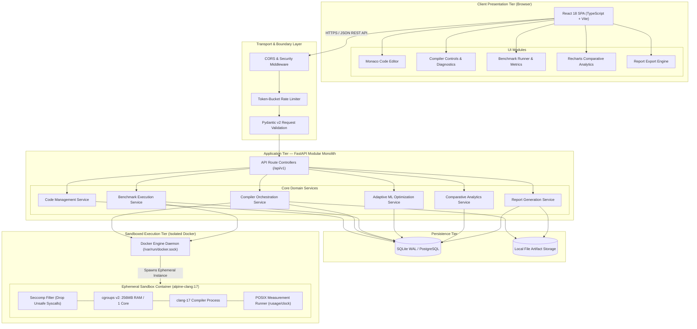
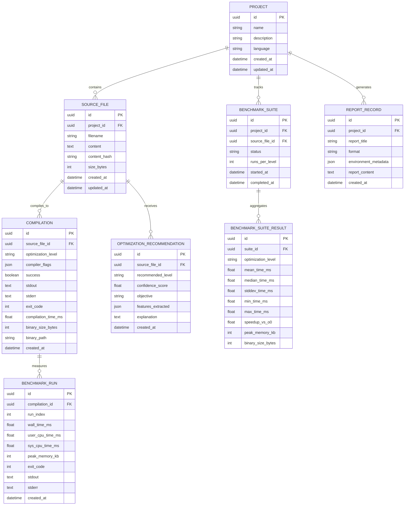

# CompilerX — System Architecture Document
**AI-Powered Adaptive Code Optimization and Performance Analysis System**

---

| Field | Value |
|---|---|
| **Document Version** | 1.0.0 |
| **Status** | DRAFT — Pending Architectural Review |
| **Author** | Principal Software Architect & Technical Lead |
| **Target Course** | Adaptive Software Engineering (24CI3201), KL University |
| **Course Outcomes Covered** | CO1 (Agile/SDLC), CO2 (DevOps/CI-CD/Docker), CO3 (SecOps/Sandboxing), CO4 (MLOps/Cloud-Ready ML), CO5 (Teamwork/Reviews) |
| **Last Updated** | 2026-11-06 |

---

## 1. Executive Summary & Architectural Philosophy

### 1.1 Executive Summary
**CompilerX** is an enterprise-grade developer platform engineered to analyze, compile, execute, benchmark, and optimize C/C++ source code through empirical measurement coupled with machine-learning-driven optimization recommendations. 

The system directly bridges three computing disciplines:
1. **Systems & Compilers:** Leveraging LLVM/Clang to inspect intermediate diagnostics, control optimization passes (`-O0`, `-O1`, `-O2`, `-O3`), and inspect generated binary characteristics.
2. **Performance Engineering:** Conducting isolated, deterministic micro-benchmarking under strict resource-bounded execution environments, measuring wall-clock time, CPU kernel/user time, peak RSS memory, and binary footprint.
3. **Applied Machine Learning (MLOps):** Extracting structural, syntactic, and algorithmic code features, mapping them to empirical performance speedups, and providing predictive optimization recommendations with explainable decision rationales.

### 1.2 Core Architectural Principles

1. **Empirical Ground Truth (Zero Fabrication):** No benchmark metric, speedup factor, or memory measurement is ever simulated, mocked, or hardcoded. Every metric rendered in the UI originates from an isolated process execution monitored via POSIX primitives and OS accounting interfaces.
2. **Deterministic Sandboxed Execution:** User-submitted source code is treated as inherently hostile and untrusted. The compilation and execution stages run inside ephemeral, unprivileged, resource-constrained container environments with no network access, dropped Linux capabilities, and strict `seccomp` system-call filtration.
3. **Pragmatic ML over Generative Hype:** Rather than querying an external Large Language Model (which hallucinates performance characteristics and requires ungrounded API calls), CompilerX implements a legitimate, reproducible Machine Learning pipeline using classical tabular ensemble models (`scikit-learn` Random Forest / Gradient Boosting) trained on concrete code features and empirical benchmark measurements.
4. **Architectural Modularity (Modular Monolith):** The backend is architected as a cohesive modular monolith with strict domain boundaries, dependency injection, and clean service interfaces. Microservices are deliberately avoided at this stage to eliminate distributed systems failure modes (network partitions, distributed transaction overhead, deployment friction) while preserving clear vertical extraction boundaries for future horizontal scaling.
5. **Alignment with Course Outcomes:** Every architectural subsystem maps directly to the KL University ASE syllabus:
   - **CO1 (Agile/SDLC):** Feature breakdown into testable user stories and modular vertical slices.
   - **CO2 (DevOps):** Multi-stage Docker containerization, Docker Compose orchestration, and automated GitHub Actions CI/CD pipelines.
   - **CO3 (SecOps):** Defense-in-depth isolation, container hardening, static analysis integration hooks, and secure coding practices.
   - **CO4 (MLOps):** End-to-end ML lifecycle management: reproducible dataset curation, feature engineering, offline model training, evaluation metrics, artifact versioning, and low-latency inference serving.
   - **CO5 (Collaborative Engineering):** Clear interface contracts, strict typing across boundaries, reproducible test fixtures, and modular repository structure facilitating multi-engineer collaboration.

---

## 2. Final Technology Stack & Technical Rationale

The technology choices below have been selected to satisfy production software engineering standards while remaining strictly reproducible, robust, and defensible in an academic defense.

```
┌────────────────────────────────────────────────────────────────────────┐
│                              FRONTEND                                  │
│  React 18 + TypeScript + Vite + Tailwind CSS + Recharts + Monaco Editor│
└───────────────────────────────────┬────────────────────────────────────┘
                                    │ HTTP / REST (OpenAPI 3.1)
┌───────────────────────────────────▼────────────────────────────────────┐
│                              BACKEND                                   │
│    Python 3.12 + FastAPI + Pydantic v2 + SQLAlchemy 2.0 (asyncio)      │
│  Modular Services: Code, Compiler, Benchmark, ML, Analytics, Reports   │
└──────────────────┬─────────────────┬───────────────────┬───────────────┘
                   │                 │                   │
┌──────────────────▼──────┐   ┌──────▼────────┐   ┌──────▼───────────────┐
│     DATA PERSISTENCE    │   │  ML SUBSYSTEM │   │  EXECUTION SANDBOX   │
│  SQLite (WAL) / Postgres│   │ scikit-learn  │   │  Docker Engine API   │
│  Alembic for Migrations │   │ Joblib Models │   │  Alpine Clang 17/18  │
└─────────────────────────┘   └───────────────┘   └──────────────────────┘
```

### 2.1 Detailed Technology Stack Matrix

| Layer | Selected Technology | Version | Alternate Considered | Rationale for Selection & Rejection of Alternative |
|---|---|---|---|---|
| **Frontend Framework** | **React** | `18.3+` | Vue 3, Svelte | **Selected:** Industry standard for developer tools; rich ecosystem for code editors, diffing tools, and charting libraries.<br>**Rejected:** Svelte has a smaller ecosystem for complex Monaco integration; Vue lacks the breadth of developer-tool UI primitives. |
| **Language (FE)** | **TypeScript** | `5.5+` | JavaScript (ESNext) | **Selected:** Compile-time type verification, shared API interface definitions with backend schemas via OpenAPI generators, reduction of UI runtime errors. |
| **Build & Tooling** | **Vite** | `5.4+` | Webpack, Turbopack | **Selected:** Sub-second Cold Start and HMR via native ES modules in development; highly optimized Rollup-based production builds. |
| **UI Styling** | **Tailwind CSS** | `3.4+` | CSS Modules, styled-components | **Selected:** High velocity, utility-first CSS ensuring strict visual consistency, zero runtime CSS overhead, native dark-mode support via CSS classes. |
| **Code Editor** | **Monaco Editor** (`@monaco-editor/react`) | `0.46+` | CodeMirror 6, Ace | **Selected:** The actual engine powering VS Code. Provides native C/C++ tokenization, syntax highlighting, bracket matching, minimization minimap, and multi-cursor support out of the box. |
| **Visual Analytics** | **Recharts** | `2.12+` | Chart.js, D3.js | **Selected:** Declarative React-native SVG charting with full TypeScript support, responsive animations, and precise customization for performance comparison graphs. |
| **Backend Framework** | **FastAPI** | `0.111+` | Django, Flask, Express.js | **Selected:** Native asynchronous I/O (`asyncio`), automatic OpenAPI/Swagger documentation generation, tight integration with Pydantic for validation, high throughput. |
| **Language (BE)** | **Python** | `3.12+` | Node.js (TS), Go, Rust | **Selected:** Python provides the strongest unified bridge between system management (Docker SDK, subprocess manipulation) and the Machine Learning ecosystem (`scikit-learn`, `numpy`). |
| **Data Validation** | **Pydantic** | `v2.7+` | Marshmallow, Cerberus | **Selected:** Rust-backed validation core (`pydantic-core`) offering sub-millisecond serialization, strict schema enforcement, and seamless FastAPI integration. |
| **ORM / Data Access** | **SQLAlchemy** | `2.0+` (async) | Tortoise ORM, Peewee | **Selected:** Enterprise-standard Python ORM featuring async engine support, robust relationship modeling, and seamless cross-database portability (SQLite ↔ PostgreSQL). |
| **Database Migrations**| **Alembic** | `1.13+` | Custom SQL scripts | **Selected:** Declarative schema migrations with deterministic rollback capabilities, version tracking in Git. |
| **Primary Database** | **SQLite (WAL Mode)** / **PostgreSQL** | SQLite 3.45+ / PG 16 | MongoDB, MySQL | **Selected:** SQLite provides zero-configuration, self-contained local development with instantaneous setup. Using SQLAlchemy allows frictionless promotion to PostgreSQL for multi-tenant production deployments. |
| **Compiler Toolchain** | **LLVM / Clang** | `17+ / 18+` (in Docker) | GCC | **Selected:** Clean diagnostic output formats, modern optimization pipeline with exposed pass infrastructure, uniform optimization flags (`-O0`, `-O1`, `-O2`, `-O3`), and modular design. |
| **Machine Learning** | **scikit-learn** | `1.5+` | PyTorch, TensorFlow, LLMs | **Selected:** Deterministic, low-latency, interpretable tabular models (Random Forest, Gradient Boosting). Extremely fast training and sub-millisecond inference on CPU without requiring GPU infrastructure. |
| **Sandboxed Execution**| **Docker Engine API** | `v26+` | gVisor, Firecracker, nsjail | **Selected:** Universally available on developer machines (Mac/Linux/Windows), standardized image distribution, granular cgroup v2 support for CPU/memory limits, seccomp integration. |
| **Structured Logging** | **structlog** | `24.1+` | Standard `logging` | **Selected:** Structured JSON logs containing request IDs, compilation hashes, and benchmark context suitable for modern observability platforms. |
| **Testing Harness** | **pytest** (BE) / **Vitest** (FE) | Latest | unittest, Jest | **Selected:** pytest provides rich fixtures, async test support, and parameterized benchmark testing; Vitest shares Vite configuration for instantaneous frontend unit testing. |

---

## 3. High-Level System Architecture

CompilerX implements a **three-tier architecture** with strict isolation boundaries:
1. **Presentation Tier:** A responsive Single Page Application (SPA) providing developer-grade interaction.
2. **Application Tier (Modular Monolith):** An asynchronous FastAPI service encapsulating business domains, database orchestration, ML inference, and container lifecycle supervision.
3. **Execution Tier (Isolated Sandbox):** An ephemeral, locked-down Docker execution sandbox isolated from the application tier and the host operating system.

### 3.1 High-Level Architecture Diagram (C4 Container View)



---

## 4. Component Breakdown & Responsibilities

The system is organized into clean, self-contained components with unidirectional dependency flows:

```
Controllers (Routes) ──► Services (Business Logic) ──► Repositories (Data Access) ──► Models (ORM)
                                 │
                                 └──► External Adapters (Docker API, scikit-learn)
```

### 4.1 Frontend Component Architecture

| Component | File / Path | Architectural Responsibility |
|---|---|---|
| **App Shell & Layout** | `src/components/layout/` | Root header, navigation bar, project selector, theme toggle (dark/light), and connection status monitor. |
| **Code Editor Workbench** | `src/components/editor/` | Houses the Monaco Editor instance, handles C/C++ syntax highlighting, cursor position tracking, file upload/download, dirty state tracking, and local autosave buffers. |
| **Compiler Control Panel** | `src/components/compiler/` | Provides optimization level selectors (`-O0`, `-O1`, `-O2`, `-O3`), custom flag whitelist toggles (`-Wall`, `-march=native`), "Compile" action trigger, and ANSI-colored terminal output for diagnostics. |
| **Benchmark Runner Panel**| `src/components/benchmark/` | Controls benchmark parameters (run repetitions $N \in [1, 10]$, custom stdin input payloads), provides execution progress indicators, and displays live timing/memory results. |
| **Comparative Analytics** | `src/components/analytics/` | Computes and displays speedup multipliers ($T_{\text{baseline}} / T_{\text{opt}}$), execution time distribution bar charts, memory consumption comparisons, and binary size deltas. |
| **ML Recommendation Card**| `src/components/ml/` | Displays the recommended optimization level, predicted performance gain, confidence score ($0.0 \dots 1.0$), and human-readable explanation based on extracted code features. |
| **Report Generator** | `src/components/reports/` | Configures and triggers exportable academic/engineering performance reports in Markdown, JSON, and printable formats. |
| **State Management** | `src/stores/` & `src/services/` | Zustand stores for transient UI state (editor buffer, active project); TanStack Query for remote server state caching, background polling, and cache invalidation. |

### 4.2 Backend Service Decomposition

The backend modular monolith segregates concerns into 6 discrete services located under `backend/app/services/`:

```
backend/app/services/
├── code_service.py       # Source code ingestion, hash verification, metadata
├── compiler_service.py   # Clang invocation, flag sanitization, binary size extraction
├── benchmark_service.py  # Sandboxed execution, rusage metrics, statistical aggregation
├── ml_service.py         # Static code feature extraction, inference, retraining
├── analytics_service.py  # Regression detection, speedup calculations, data aggregation
└── report_service.py     # Markdown/JSON audit report compilation & metadata stamping
```

#### 1. CodeService (`code_service.py`)
- **Responsibilities:**
  - Manages CRUD operations for `Project` and `SourceFile` entities.
  - Computes cryptographic digests (SHA-256) of code contents for deduplication and caching.
  - Enforces file size limitations (maximum 1 MB per source file).
  - Performs initial syntactic sanity checks (valid UTF-8, balanced braces check).

#### 2. CompilerService (`compiler_service.py`)
- **Responsibilities:**
  - Validates and sanitizes compiler flags against a strict security whitelist.
  - Prepares compilation payloads for the execution sandbox.
  - Dispatches compilation commands to the Docker sandbox or local Clang toolchain.
  - Captures compilation duration (in milliseconds), compiler `stdout`, `stderr`, warnings, and exit codes.
  - Extracts binary artifact metadata: ELF/Mach-O section sizes (`.text`, `.data`, `.bss`), total binary byte size.
  - Persists `Compilation` records linked to the specific source file hash.

#### 3. BenchmarkService (`benchmark_service.py`)
- **Responsibilities:**
  - Orchestrates isolated execution of compiled binaries within ephemeral Docker containers.
  - Injects user-provided `stdin` test fixtures.
  - Enforces wall-clock execution deadlines (timeout threshold: default 10s, max 30s).
  - Executes repeated benchmark runs ($N=3$ to $N=10$) to account for OS scheduling jitter.
  - Collects precise metrics:
    - **Wall-clock time:** Monotonic high-resolution clock (`CLOCK_MONOTONIC_RAW`).
    - **CPU time:** User-space CPU time and Kernel-space CPU time via `getrusage(RUSAGE_CHILDREN)`.
    - **Peak Resident Set Size (RSS):** Maximum physical memory footprint in kilobytes.
  - Computes statistical aggregates: Mean ($\mu$), Median, Sample Standard Deviation ($\sigma$), Minimum, Maximum, and Variance.

#### 4. MLService (`ml_service.py`)
- **Responsibilities:**
  - **Feature Extraction Engine:** Parses source code to compute a 16-dimensional numeric feature vector (LOC, cyclomatic complexity, loop nesting depth, pointer arithmetic density, floating-point operation ratio, branch density, etc.).
  - **Inference Engine:** Loads serialized `scikit-learn` pipeline (`joblib`) to predict the optimal optimization configuration (`-O0`, `-O1`, `-O2`, `-O3`) based on an optimization objective (`SPEED`, `SIZE`, or `BALANCED`).
  - **Explainability Provider:** Computes feature contributions (via Random Forest tree feature importances) to formulate natural-language justification strings (e.g., *"High loop nest depth (3) and dense floating-point arithmetic indicate high potential for auto-vectorization under -O3"*).
  - **Dataset Management & Retraining:** Maintains an offline dataset of microbenchmarks and provides an endpoint to trigger model retraining as empirical observations accumulate.

#### 5. AnalyticsService (`analytics_service.py`)
- **Responsibilities:**
  - Computes comparative speedup factors:
    $$\text{Speedup} = \frac{\text{Mean Execution Time}(O0)}{\text{Mean Execution Time}(O_x)}$$
  - Computes binary size overhead percentages:
    $$\Delta_{\text{Size}} = \frac{\text{Size}(O_x) - \text{Size}(O0)}{\text{Size}(O0)} \times 100\%$$
  - Identifies performance regressions (where a higher optimization level degrades runtime or balloons binary size).
  - Generates timeseries aggregates for historical project evolutions.

#### 6. ReportService (`report_service.py`)
- **Responsibilities:**
  - Assembles end-to-end performance audits into structured Markdown, JSON, and HTML.
  - Stamps execution environment metadata (Host CPU model, microarchitecture, cache sizes, OS kernel version, Clang toolchain version, RAM limits).
  - Embeds raw benchmark distributions, compilation logs, and ML recommendation rationales.

---

## 5. Frontend/Backend Communication Protocol

The frontend and backend communicate exclusively over a typed, stateless HTTP REST interface using JSON payloads.

```
Frontend (React) ──[HTTP POST /api/v1/files/:id/compile]──► Backend (FastAPI)
Frontend (React) ◄──[HTTP 201 Created + Compilation JSON]─── Backend (FastAPI)
```

### 5.1 Communication Standards
- **Base URI:** `/api/v1`
- **Payload Format:** Strict JSON (`application/json; charset=utf-8`)
- **Identification:** UUIDv4 for all persistent resources (`project_id`, `file_id`, `compilation_id`, `suite_id`).
- **Standardized Error Envelope:** All non-2xx HTTP responses return a consistent error structure:

```json
{
  "error": "COMPILATION_FAILED",
  "message": "Clang exited with return code 1 due to syntax errors.",
  "status_code": 400,
  "details": {
    "file_id": "9b1deb4d-3b7d-4bad-9bdd-2b0d7b3dcb6d",
    "stderr": "main.c:4:5: error: expected ';' after expression\n    int x = 10\n              ^"
  },
  "timestamp": "2026-11-06T12:00:00.000Z"
}
```

### 5.2 Primary API Endpoint Catalog

```
/api/v1
├── /projects
│   ├── POST   /                  -> Create project
│   ├── GET    /                  -> List projects
│   ├── GET    /{id}              -> Retrieve project details & file tree
│   └── DELETE /{id}              -> Cascade delete project
├── /files
│   ├── POST   /projects/{pid}/files -> Create/upload source file
│   ├── GET    /{id}              -> Retrieve file content & metadata
│   ├── PUT    /{id}              -> Update file content
│   └── DELETE /{id}              -> Delete file
├── /compilation
│   ├── POST   /files/{id}/compile-> Trigger compilation with flags
│   ├── GET    /{id}              -> Get compilation record & binary info
│   └── GET    /files/{id}/history-> Get compilation history for file
├── /benchmarks
│   ├── POST   /run               -> Execute single benchmark run
│   ├── POST   /suite             -> Execute full multi-level suite (-O0 to -O3)
│   └── GET    /suite/{id}        -> Get benchmark suite status & aggregated stats
├── /optimization
│   ├── POST   /recommend         -> Extract features & predict optimal flags
│   ├── GET    /features/{file_id}-> Inspect extracted 16D feature vector
│   └── GET    /model/metrics     -> Retrieve ML model accuracy & confusion matrix
├── /analytics
│   └── GET    /projects/{id}/summary -> Get project-wide optimization matrix
└── /reports
    └── POST   /generate          -> Compile and export comprehensive audit report
```

### 5.3 Asynchronous Execution & Polling Contract
Because compiling and running multi-iteration benchmark suites can exceed standard HTTP request timeouts (taking 5–15 seconds total), the system provides both:
1. **Direct Synchronous Execution:** For fast single-run compilations and quick benchmarks ($N \le 3$).
2. **Job-Based Polling:** For comprehensive suites (`POST /benchmarks/suite` returns `202 Accepted` with a `suite_id`). The frontend queries `GET /benchmarks/suite/{suite_id}` with exponential backoff until `status: "COMPLETED" | "FAILED"`.

---

## 6. Compiler Integration Architecture

```
User Source Code (.c / .cpp)
             │
             ▼
[CompilerService Flag Sanitizer] ──(Rejects unapproved flags)
             │
             ▼
[Construct Programmatic Clang Command Line]
  clang -O2 -Wall -fdiagnostics-color=never -o /tmp/build/binary /tmp/build/source.c
             │
             ▼
[Docker Execution Sandbox]
  ├── Mount: Memory tmpfs -> /tmp/build
  ├── Subprocess: clang invocation with 15s deadline
  └── Capture: stdout, stderr, exit code, compilation duration
             │
             ▼
[Binary Inspection Subsystem]
  ├── llvm-size / size binary -> extract .text, .data, .bss byte sizes
  └── stat binary -> total binary size
```

### 6.1 Compiler Flag Whitelist & Security Sanitization
Under no circumstances are raw flag strings concatenated or passed to a shell interpreter. Flags are checked against an explicit, immutable allowlist:

```python
ALLOWED_OPTIMIZATION_LEVELS = {"-O0", "-O1", "-O2", "-O3", "-Os", "-Oz"}

ALLOWED_COMPILER_FLAGS = {
    # Warning controls
    "-Wall", "-Wextra", "-pedantic", "-Wno-unused-variable",
    # Language Standards
    "-std=c99", "-std=c11", "-std=c17",
    "-std=c++14", "-std=c++17", "-std=c++20",
    # Math & Optimization specifics
    "-ffast-math", "-fno-math-errno", "-fomit-frame-pointer",
    "-funroll-loops", "-fvectorize", "-fslp-vectorize"
}
```
Any flag outside this enumeration triggers an immediate `422 Unprocessable Entity` response before reaching the container daemon.

### 6.2 Compilation Diagnostic Extraction
Clang diagnostics (`stderr`) are parsed into structured compiler diagnostic objects:
- Severity level: `NOTE`, `WARNING`, `ERROR`, `FATAL`
- Line and Column numbers
- Message body
- Source code caret pointer

---

## 7. Benchmarking Pipeline & Measurement Harness

Precision microbenchmarking requires rigorous isolation to minimize measurement noise introduced by CPU frequency scaling, process scheduling, and cache effects.

### 7.1 Measurement Harness Execution Sequence

```mermaid
sequenceDiagram
    autonumber
    participant App as BenchmarkService
    participant Host as Docker Engine API
    participant Box as Ephemeral Sandbox Container
    participant Harness as C-Runner Harness (/runner)
    participant Bin as Compiled User Binary

    App->>Host: Create container (cpus=1.0, mem=256MB, network=none, ro-root)
    App->>Host: Copy compiled binary into container tmpfs (/tmp/bin)
    App->>Host: Start container with runner command
    Host->>Box: Launch Process
    Box->>Harness: /runner /tmp/bin --runs 5 --timeout 5000
    
    loop For run i = 1 to N
        Harness->>Harness: clock_gettime(CLOCK_MONOTONIC_RAW, &start)
        Harness->>Bin: fork() + execve(/tmp/bin) with stdin pipe
        Bin-->>Harness: Process terminates / exit code
        Harness->>Harness: clock_gettime(CLOCK_MONOTONIC_RAW, &end)
        Harness->>Harness: getrusage(RUSAGE_CHILDREN, &usage)
        Harness->>Harness: Record: elapsed_ns, user_cpu_ns, sys_cpu_ns, maxrss_kb
    end

    Harness->>Box: Format JSON output to stdout
    Box-->>Host: stdout stream
    Host-->>App: Raw execution payload JSON
    App->>App: Validate exit codes & filter outliers
    App->>App: Compute Mean, Median, StdDev, Min, Max
    App->>Host: Force Remove Container (Immediate cleanup)
```

### 7.2 Measurement Metrics & Collection Primitives
The benchmarking runner does not rely on Python's high-level `time.time()`, which measures host system time subject to NTP shifts. Instead, it utilizes a dedicated low-overhead C measurement wrapper (`runner.c`) executing natively inside the container:

1. **Wall-Clock Time:** Measured via `clock_gettime(CLOCK_MONOTONIC_RAW, &ts)`, which directly samples the hardware cycle counter without NTP slewing.
2. **CPU User Time:** Measured via `struct rusage.ru_utime`, capturing CPU time spent exclusively in user-mode code.
3. **CPU System Time:** Measured via `struct rusage.ru_stime`, capturing CPU time spent in kernel syscalls.
4. **Peak Memory (Resident Set Size):** Extracted via `struct rusage.ru_maxrss` (reported in kilobytes on Linux).
5. **Output Verification:** Hashes `stdout` across runs to verify that optimization flags did not alter program correctness or introduce undefined behavior.

### 7.3 Statistical Aggregation Schema
For a benchmark suite consisting of $N$ valid runs ($N \ge 3$):
- **Mean ($\mu$):** $\mu = \frac{1}{N} \sum_{i=1}^N t_i$
- **Sample Standard Deviation ($s$):** $s = \sqrt{\frac{1}{N-1} \sum_{i=1}^N (t_i - \mu)^2}$
- **Median ($M$):** 50th percentile of sorted runtimes (robust against context-switch spikes).
- **Coefficient of Variation ($CV$):** $CV = \frac{s}{\mu} \times 100\%$. If $CV > 15\%$, the benchmark run is visually flagged with a **High Variance Warning**, informing the developer of measurement instability.

---

## 8. Adaptive Machine Learning Pipeline (MLOps)

The machine learning system fulfills course outcome **CO4 (MLOps)**. It replaces arbitrary heuristic guesses with a trainable, reproducible tabular classification model that maps structural code features to optimal compiler flags.

```
Source Code
    │
    ▼
[AST / Lexical Feature Extractor]
    │ (Computes 16D numeric feature vector)
    ▼
┌────────────────────────────────────────────────────────┐
│ 16D Feature Vector:                                    │
│ [LOC, CC, Loops, MaxNesting, FloatOps, IntOps, ...]    │
└──────────────────────────┬─────────────────────────────┘
                           │
                           ▼
          [StandardScaler / Normalizer]
                           │
                           ▼
          [Random Forest Classifier (100 Trees)]
                           │
              ┌────────────┴────────────┐
              ▼                         ▼
   Predicted Best Flag           Confidence Score
       "-O3" (0.84)                   84.2%
              │
              ▼
   [Explainability Engine (SHAP / Feature Importance)]
   "High loop nesting (depth 3) & vectorizable arithmetic"
```

### 8.1 Extracted Feature Taxonomy (16 Dimensions)

The feature extractor (`features.py`) parses the source code using regex tokenization and structural tree heuristics to compute the following 16 numerical descriptors:

| Feature Name | Type | Description | Optimization Relevance |
|---|---|---|---|
| `lines_of_code` | Integer | Total non-empty, non-comment lines | Correlates with inlining overhead and code size. |
| `function_count` | Integer | Number of defined function declarations | Indicates inter-procedural optimization potential. |
| `cyclomatic_complexity` | Integer | McCabe complexity: $E - N + 2P$ (branches + 1) | High complexity impedes aggressive loop unrolling. |
| `loop_count` | Integer | Total `for`, `while`, `do-while` loops | Primary target for `-O2`/`-O3` loop optimizations. |
| `max_loop_nesting_depth`| Integer | Deepest nested loop level | Nesting $\ge 2$ yields massive speedups under `-O3`. |
| `integer_arithmetic_ops`| Integer | Counts of `+`, `-`, `*`, `/`, `%` on integers | Basic arithmetic intensity. |
| `float_arithmetic_ops`  | Integer | Counts of floating-point calculations | Indicates potential for SIMD vectorization. |
| `pointer_dereferences`  | Integer | Occurrences of `*ptr`, `->`, `&` | Heavy aliasing restricts compiler reordering. |
| `array_subscript_ops`   | Integer | Occurrences of `arr[i]` indexing | Target for vectorization and bounds elimination. |
| `branch_count`          | Integer | Occurrences of `if`, `else`, `switch`, `case` | Branch predictor stress; high branches favor `-O2`. |
| `recursive_call_count`  | Integer | Self-referential function calls | Recursion resists loop vectorization. |
| `bitwise_ops`           | Integer | Counts of `&`, `|`, `^`, `<<`, `>>` | Bit-manipulation instructions (popcnt, bswap). |
| `memory_allocation_ops` | Integer | Occurrences of `malloc`, `calloc`, `free` | Heap overhead; memory-bound rather than compute-bound. |
| `math_library_calls`    | Integer | Occurrences of `sqrt`, `pow`, `sin`, `cos` | Benefits strongly from `-ffast-math`. |
| `global_variable_count` | Integer | Variables defined outside function scopes | Global state inhibits register allocation. |
| `arithmetic_to_branch_ratio`| Float | $\frac{\text{Arithmetic Ops}}{\text{Branch Count} + 1}$ | Determines if workload is compute- or control-bound. |

### 8.2 Model Selection, Training, and Evaluation Methodology

1. **Target Labels:** Multiclass classification where the classes are:
   $$y \in \{\text{"-O0"}, \text{"-O1"}, \text{"-O2"}, \text{"-O3"}\}$$
   The ground truth label for a benchmarked training program is defined as:
   $$y^* = \arg\min_{k \in \{0,1,2,3\}} \text{Mean Runtime}(O_k)$$
   *(Or alternatively, maximizing speedup subject to binary size constraint if objective is `BALANCED`).*

2. **Algorithm:** **Random Forest Classifier** (`n_estimators=100`, `max_depth=8`, `random_state=42`).
   - *Why Random Forest?* Tabular code features exhibit non-linear threshold relationships (e.g., if `loop_count > 0` AND `pointer_dereferences == 0`, vectorization is highly effective). Random Forests resist overfitting on small-to-medium datasets, require zero feature scaling, and expose exact Gini-importance metrics for explainability.

3. **Cold-Start Benchmark Corpus:**
   CompilerX ships with a curated synthetic corpus of **50 canonical C programs** spanning distinct computational profiles:
   - *Dense Linear Algebra:* Matrix multiplication, LU decomposition, vector dot products.
   - *Sorting & Searching:* Quicksort, Mergesort, Radix sort, Binary search.
   - *Discrete Math & Cryptography:* Sieve of Eratosthenes, SHA-256 micro-kernel, Fibonacci.
   - *Control-Flow Intensive:* State machines, recursive tree traversals, parsing algorithms.
   - *Memory-Bound:* Linked list pointer chasing, hash map probing.

4. **Evaluation Metrics:**
   - Classification Accuracy
   - Macro-averaged Precision, Recall, and F1-Score
   - Full Multiclass Confusion Matrix
   - Out-of-Bag (OOB) Score

### 8.3 Explainability Engine
The `ml_service.py` inspects the top split decisions of the forest. If a program is recommended `-O3`, the engine outputs human-understandable rationales such as:
> *"Recommended **-O3** (Confidence: 87.4%). Extracted code features indicate a high loop nesting depth of 3 and an arithmetic-to-branch ratio of 4.2. Clang's Loop Vectorizer and SLP Vectorizer provide substantial performance advantages for this compute-heavy profile."*

---

## 9. Data Persistence Architecture

The persistence layer is managed via **SQLAlchemy 2.0 async ORM** paired with **Alembic** migrations. It supports **SQLite** (configured with Write-Ahead Logging for high concurrency in local environments) and is 100% schema-compatible with **PostgreSQL 16**.

### 9.1 Relational Entity-Relationship Diagram



---

## 10. Docker Execution Architecture & Isolation Sandbox

Treating user code as untrusted is non-negotiable (**Course Outcome CO3: SecOps**). Malicious users can submit fork bombs, infinite loops, memory exhausters, filesystem wipers (`rm -rf /`), or network backdoors.

CompilerX implements a **Defense-in-Depth** container execution sandbox:

```
┌────────────────────────────────────────────────────────────────────────┐
│                        HOST OPERATING SYSTEM                           │
│  FastAPI Backend (Non-Root User) ──► Docker Engine Daemon              │
└───────────────────────────────────┬────────────────────────────────────┘
                                    │
               Docker API (Unix Domain Socket / TLS)
                                    │
┌───────────────────────────────────▼────────────────────────────────────┐
│                  EPHEMERAL DOCKER SANDBOX CONTAINER                    │
│                                                                        │
│  [1. Namespace Isolation]                                              │
│      PID, MNT, NET, IPC, UTS, USER namespaces isolated                 │
│                                                                        │
│  [2. Network Isolation]                                                │
│      --network none (Complete network denial, no external routing)     │
│                                                                        │
│  [3. Filesystem Hardening]                                             │
│      --read-only (Root filesystem mounted strictly read-only)          │
│      --tmpfs /tmp:size=64M,noexec,nodev,nosuid (In-memory scratch)     │
│      --tmpfs /build:size=64M,exec,nodev (Ephemeral compile target)     │
│                                                                        │
│  [4. Linux Capabilities]                                               │
│      --cap-drop=ALL (Drops all capabilities, including root cap)       │
│      --security-opt=no-new-privileges:true (Prevent setuid escalation)  │
│                                                                        │
│  [5. Seccomp Syscall Whitelist]                                        │
│      Blocks: socket(), clone(), ptrace(), mount(), reboot(), etc.      │
│      Allows: read(), write(), exit_group(), clock_gettime(), mmap()    │
│                                                                        │
│  [6. cgroups v2 Resource Budgets]                                      │
│      --cpus=1.0 (Hard limit: exactly 1 CPU core)                       │
│      --memory=256m (Hard limit: 256 MB RAM total)                      │
│      --pids-limit=64 (Hard limit: strictly prevents fork bombs)        │
│                                                                        │
│  [7. Temporal Deadlines]                                               │
│      Hard SIGKILL enforced by supervisor after 10.0 seconds            │
└────────────────────────────────────────────────────────────────────────┘
```

### 10.1 Sandbox Image Specification (`sandbox/Dockerfile`)
The sandbox runs a custom, lightweight container image based on **Alpine Linux** or **Ubuntu Minimal**:
- Contains: `clang`, `lld`, `llvm-dev`, `musl-dev` (or `build-essential`), and our custom compiled C benchmark runner (`runner`).
- Does **not** contain: `curl`, `wget`, `python`, `bash`, `ssh`, or package management utilities.
- Operates under an unprivileged user (`compilerx:uid=1001:gid=1001`).

---

## 11. Security Boundaries & Threat Modeling

In alignment with **OWASP Top 10** and SecOps standards (CO3), the system guards against specific threat vectors:

| Threat Vector | Attack Scenario | Architectural Countermeasure |
|---|---|---|
| **Remote Code Execution (RCE) on Host** | User submits `system("rm -rf /")` or `execve()` in C code. | Code executes inside Docker container with dropped root capabilities, read-only rootfs, and no host volume mounts. |
| **Compiler Denial of Service (DoS)** | Recursive macro bombs (`#include __FILE__`) or template metaprogramming freezing Clang. | Clang compilation is executed under an OS-enforced 15-second timeout; killed with `SIGKILL` on expiration. |
| **Process / Fork Bombs** | User submits C code with infinite `while(1) fork();`. | Container is enforced with `--pids-limit=64`. Process creation fails with `EAGAIN` once exhausted. |
| **Memory Exhaustion (OOM)** | Program allocates multiple gigabytes via `malloc(1024*1024*1024)`. | Container is constrained to 256MB RAM via cgroups. Linux OOM-killer immediately terminates the process; status captured as `OOM_KILLED`. |
| **Command Injection in Backend** | Malicious compiler flags passed via API (e.g. `; cat /etc/passwd;`). | No raw shell commands (`shell=True`) are ever executed. Subprocesses are called with explicit vector arguments `["clang", "-O2", ...]`. Flags are strictly whitelisted. |
| **Network Exfiltration / SSRF** | User writes socket code attempting to access host metadata or internal networks. | Containers are instantiated with `--network none`, completely unlinking the virtual network interface. |
| **API Denial of Service** | Automated script flooding compilation endpoints. | Token-bucket rate limiting enforced in FastAPI middleware (10 compilations/min, 5 benchmarks/min per IP). |

---

## 12. Deployment Architecture & CI/CD Pipeline

The platform is designed for zero-friction local developer execution and automated continuous delivery.

### 12.1 Docker Compose Multi-Container Topology

```yaml
version: '3.8'

services:
  # 1. Frontend Web Client (React + Nginx)
  frontend:
    build:
      context: ./frontend
      dockerfile: Dockerfile
    ports:
      - "3000:80"
    depends_on:
      - backend
    networks:
      - compilerx-network

  # 2. Application Backend (FastAPI + Python 3.12)
  backend:
    build:
      context: ./backend
      dockerfile: Dockerfile
    ports:
      - "8000:8000"
    environment:
      - DATABASE_URL=sqlite+aiosqlite:////app/data/compilerx.db
      - DOCKER_SOCKET=/var/run/docker.sock
      - ENVIRONMENT=production
    volumes:
      - backend-data:/app/data
      - /var/run/docker.sock:/var/run/docker.sock # For controlling sandbox
    networks:
      - compilerx-network

volumes:
  backend-data:

networks:
  compilerx-network:
    driver: bridge
```

### 12.2 GitHub Actions CI/CD Pipeline (`.github/workflows/ci.yml`)
To satisfy **Course Outcome CO2 (DevOps)**, every commit and pull request triggers automated validation:

```
[Git Push / PR]
       │
       ├──► Job 1: Static Code Analysis & Linting
       │     ├── Backend: ruff check & black --check & mypy
       │     └── Frontend: eslint & tsc --noEmit
       │
       ├──► Job 2: Automated Testing
       │     ├── Backend: pytest tests/ (Unit + Service tests)
       │     └── Frontend: vitest run (Component & Store tests)
       │
       ├──► Job 3: Security & Vulnerability Audit (SecOps - CO3)
       │     ├── Trivy vulnerability scan on Dockerfile
       │     └── pip-audit for Python dependencies
       │
       └──► Job 4: Build Verification
             ├── Build production React bundle via Vite
             └── Build Backend & Sandbox Docker container images
```

---

## 13. Architectural Trade-offs & Evaluation Panel Defense

This section prepares the team to defend technical decisions during the academic evaluation:

### 1. Why a Modular Monolith instead of Microservices?
- **Defense:** Microservices introduce network serialization overhead, distributed tracing requirements, and container orchestration complexity (Kubernetes) that yield zero benefit for single-tenant, course-scale workloads. A modular monolith enforces strict code separation via Python modules and service interfaces while maintaining sub-millisecond in-process function calls and simple single-command deployment.

### 2. Why Clang/LLVM instead of GCC?
- **Defense:** Clang was built from the ground up as a modular library with clean, programmatic diagnostic messages, consistent optimization levels, and an explicit pass manager. GCC's diagnostics are historically text-oriented and harder to parse machine-reliably.

### 3. Why classical Machine Learning (Random Forest) instead of an LLM API?
- **Defense:** An LLM does not perform adaptive optimization; it regurgitates token probabilities based on prompt text, cannot guarantee execution performance, incurs high API latency (1–3 seconds), and requires internet connectivity. Our Random Forest model executes in under 2 milliseconds, is completely offline, is trained on empirical ground-truth benchmark data, and uses quantifiable feature importance metrics for explainability (directly satisfying CO4).

### 4. Why POSIX `clock_gettime` over Python's `time` library?
- **Defense:** Python's execution inside an interpreter introduces garbage collection pauses, GIL contention, and JIT/interpreter warmup noise. By executing our measurements in a dedicated compiled C harness (`runner.c`), we isolate the measurement overhead to $<1$ microsecond and ensure pure user/kernel time accounting via OS-level `rusage`.

---

*End of Architecture Blueprint. This document serves as the single source of architectural truth for all subsequent design and implementation phases.*

